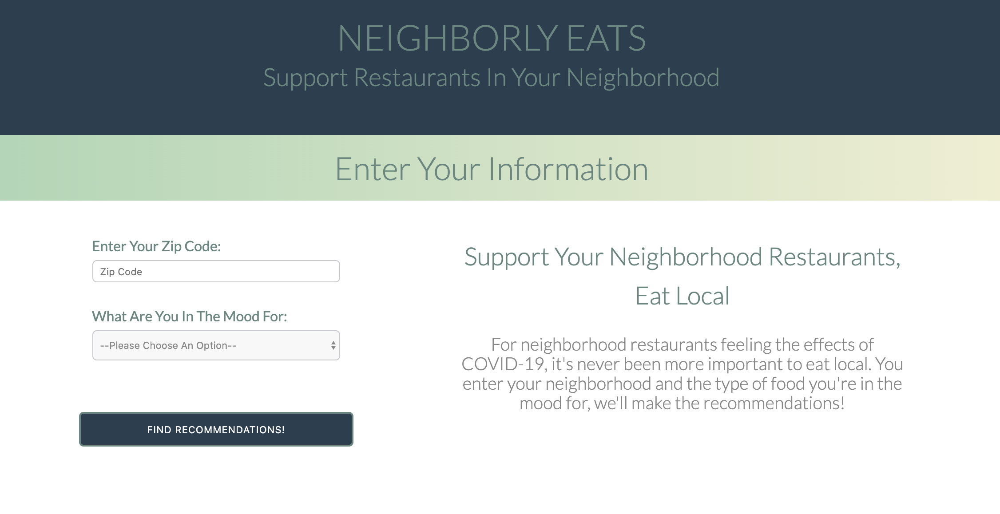
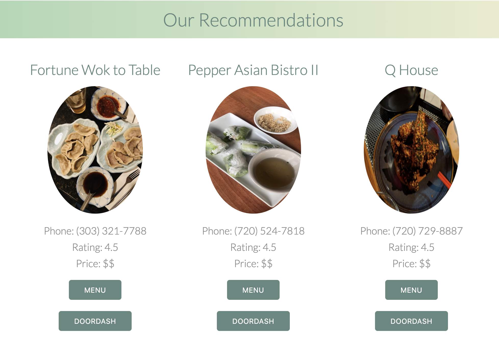
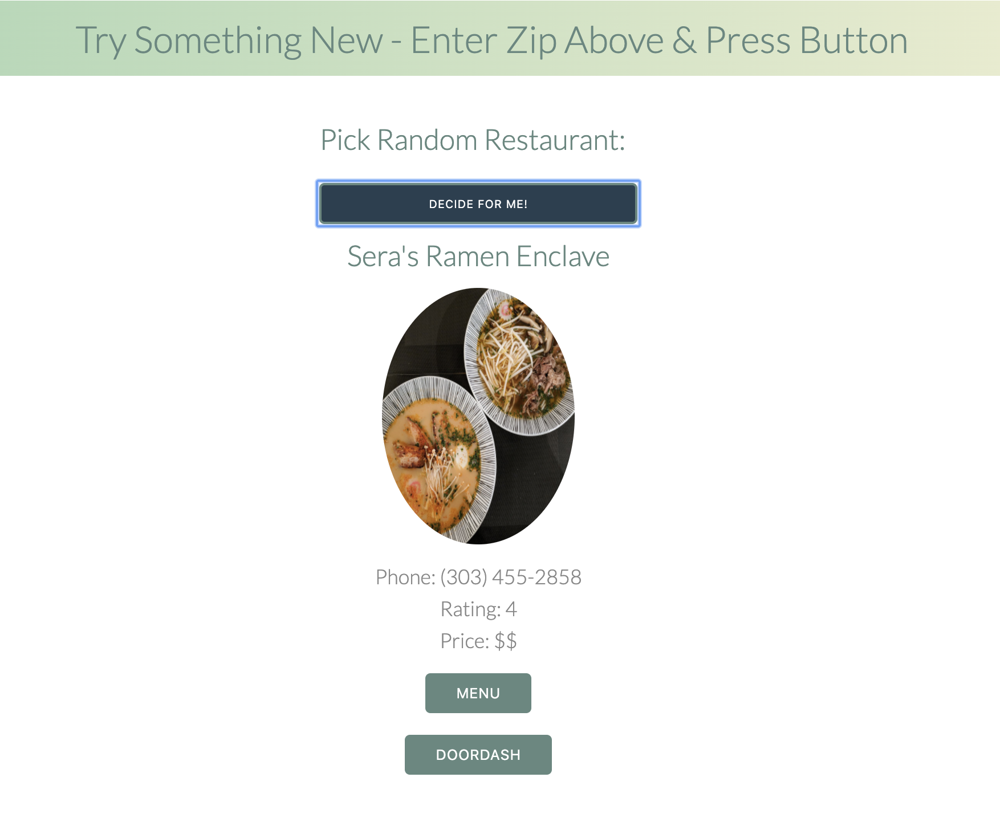

# Neighborly Eats Local Restaurant Recommendation Application

## App Available:
* [Neighborly Eats](https://neighborly-eats.herokuapp.com/)

---

### Background
* This app was designed and created with a strict three day timeline to produce a minimum viable product from scratch. My hope is that people will use it to find nearby restaurants to order take out and help support local restaurants during the Coronavirus pandemic.

### Features
* Utilizes user input for location and food type to make relavent recommendations.

---
* Intuitive recommendations to encourage and enable ordering.

---
* Random restaurant finder for undecided users

---

### Technoligies Used
* Front End:            React.js
* Back End:             Express/Node.js
* Restaurant Database:  Yelp Fusion API

### Environment Variables
* This app requires a Yelp Fusion API key. Copy `.env.example` to `.env` and set `YELP_KEY` to your key (obtain one at https://www.yelp.com/developers/v3/manage_app). `.env` is git-ignored.
* **Security note:** a Yelp API key was previously committed to source control (`seed.js`). It has been removed from the source, but it still exists in the git history and must be rotated/revoked in the Yelp developer dashboard.

### Known Bugs
* Responsive CSS
* Location Accuracy
